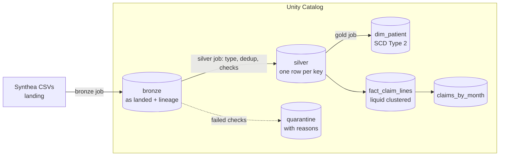

<picture>
  <source media="(prefers-color-scheme: dark)" srcset="assets/banner-dark.svg">
  
</picture>

[](https://github.com/pawanyandapalli7/data-engineer-portfolio/actions/workflows/ci.yml)
[](https://pawanyandapalli7.github.io/data-engineer-portfolio/)
[](https://www.pawanyandapalli.com)
[](https://www.pawanyandapalli.com/Pawan_Yandapalli_Resume.pdf)
[](https://www.linkedin.com/in/pawanyandapalli/)

I'm a data engineer with 5+ years of building data and ML platforms. Most
recently I worked on Molina Healthcare's lakehouse on Azure Databricks and
Snowflake (through TouchWorld), and before that on data infrastructure at Amazon.

This repo is where I build the same kinds of systems in the open. Each project
has tests for the cases that break pipelines in production: late and
out-of-order data, replays, deletes, schema drift, bad rows that must be kept,
and models that shouldn't ship. CI runs every suite on each push and publishes
the results, which is where the test counts on this page and on my site come from.

## Projects, and how far each one goes

| Project | The hard part it handles | Tests (live from CI) | Runs locally | Case study |
|---|---|---|---|---|
| **[Azure lakehouse](projects/azure-lakehouse)** | Config-driven Bronze → Silver → Gold, quarantine, SCD2, Unity Catalog, Terraform |  | `make test` | [read](https://www.pawanyandapalli.com/work/azure-lakehouse) |
| **[MLOps: claims model](projects/mlops-claims-model)** | MLflow registry, a promotion gate that refuses worse models, PSI drift alerts, serving by alias |  | `docker compose` | – |
| [dbt claims marts](projects/dbt-claims-marts) | Same data SQL-first: snapshot SCD2, incremental fact with an enforced contract, unit test |  | `dbt build` | – |
| [CDC snapshot job](projects/cdc-pipeline) | Out-of-order changes, NULL-op full loads, same-commit ties, deletes |  | `spark-submit` | – |
| [Data quality checks](projects/data-quality) | Contracts, rules that tag instead of drop, value-level reconciliation |  | `pytest` | – |
| [Feature store](projects/feature-store) | Rolling features from Kafka, replay-safe, point-in-time training SQL |  | `docker compose` | [read](https://www.pawanyandapalli.com/work/feature-store) |
| [RAG pipeline](projects/rag-pipeline) | Indexable embeddings, atomic re-ingest, token budget, real citations |  | `docker compose` | [read](https://www.pawanyandapalli.com/work/rag-pipeline) |
| [LLM eval harness](projects/llm-eval-harness) | Judge scores, a separate hallucination verdict, retrieval metrics |  | `pytest` | [read](https://www.pawanyandapalli.com/work/llm-eval) |
| [Patterns](patterns) | SQL, Spark, Airflow 3, Glue/Lambda, Snowflake, Unity Catalog governance |  | varies | – |

None of these is deployed to a cloud account yet, and nothing here claims
production traffic, benchmarks that weren't run, or eval results that weren't
published. Numbers that do appear (like the model scores below) come from runs
anyone can reproduce with the commands in each project.
[The CI evidence page](https://pawanyandapalli7.github.io/data-engineer-portfolio/) lists every
project's latest results with the commit that produced them.

## Flagship: Azure lakehouse

Synthetic patient and claims data (Synthea, no real PHI) moving through a
governed medallion architecture on Azure Databricks: the pattern I used at
Molina, rebuilt small enough to run on a laptop.



- **Sources are config, not code.** Columns, types, keys and data-quality rules
  for each source live in one YAML file; adding a source doesn't touch Python.
- **Bad rows are evidence.** Rejected rows land in a quarantine table with the
  checks they failed, and the job fails loudly if more than 5% of a source is bad.
- **Safe to re-run.** Bronze skips batches it has loaded, Silver merges on the
  latest version, and SCD2 is idempotent, including two changes on the same day.
- **No secrets.** Storage keys are disabled; Unity Catalog reaches ADLS through a
  managed identity. Two Terraform stages plus a Databricks Asset Bundle deploy it.

The [dbt claims marts](projects/dbt-claims-marts) model the same files SQL-first,
so the two approaches can be compared on identical data.

## MLOps: a model that only ships when it's better

A claims-denial classifier with the lifecycle I supported at Molina (MLflow
tracking and Model Registry, drift monitoring), on synthetic data. A real run:

| Version | Model | ROC AUC | Promoted? |
|---|---|---|---|
| 1 | Gradient boosting | 0.692 | Yes, no champion yet |
| 2 | Logistic regression | 0.715 | Yes, beat v1 |
| 3 | Baseline | 0.471 | **No.** Registered, champion unchanged, reason logged |

The same champion scored on a shifted batch raises a drift alert (prediction
PSI 0.27; `days_to_submit` 0.32), and on a normal batch stays quiet (0.01).
**[Project](projects/mlops-claims-model)**

## The other projects

<details>
<summary><b>dbt claims marts</b>: snapshot SCD2, incremental fact, enforced contract</summary>

<br>

Staging views, a quarantine model, an SCD2 snapshot, an incremental fact with
`on_schema_change: fail` and an enforced contract, 20 data tests, a unit test,
and a build-failing circuit breaker at 5% bad claims. Two pytest checks prove a
second build changes nothing and that a patient move creates a new version.
**[Project](projects/dbt-claims-marts)**
</details>

<details>
<summary><b>CDC snapshot job</b>: DMS change files to a correct current-state table</summary>

<br>

The naive "latest row per key, drop deletes" query has four quiet bugs. This
job and its tests cover each one: late arrivals ordered by commit time,
DMS full-load rows whose `op` is NULL (which `op != 'D'` silently drops),
several changes in one commit, and delete-after-update.
**[Project](projects/cdc-pipeline)**
</details>

<details>
<summary><b>Data quality checks</b>: contracts, rules and reconciliation that keep the evidence</summary>

<br>

Rules are SQL expressions in a dict; failing rows get tagged with every rule
they broke. Reconciliation compares sums as well as counts, so "right number of
rows, wrong values" fails. Generic `unique` / `not_null` / `accepted_values`
SQL tests run on Spark SQL in CI.
**[Project](projects/data-quality)**
</details>

<details>
<summary><b>Real-time feature store</b>: Kafka → Redis + Snowflake without training/serving skew</summary>

<br>

Rolling 1h/24h velocity features per user in Redis, event-log history in
Snowflake, and a point-in-time training query. One test feeds the same events
to both paths and asserts identical features. Offsets are committed only after
writes succeed, and replays don't double count.
**[Project](projects/feature-store)**
</details>

<details>
<summary><b>RAG pipeline</b>: chunking, pgvector retrieval and cited answers</summary>

<br>

Integration tests run every SQL statement against a real pgvector service in
CI. Fixes that came out of testing: 3072-dim embeddings can't be indexed by
pgvector (now 1536 with HNSW), re-ingesting a shorter document left stale
chunks (now one atomic replace), and citations list only what the answer cited.
**[Project](projects/rag-pipeline)**
</details>

<details>
<summary><b>LLM evaluation harness</b>: deciding between models with data</summary>

<br>

LLM-as-judge scoring with a separate hallucination verdict, lexical
groundedness, p50/p95 latency and per-model cost, plus precision@k, recall@k
and MRR for retrieval. The judge can be any OpenAI-compatible endpoint. No
results are published yet.
**[Project](projects/llm-eval-harness)**
</details>

## Patterns

Smaller pieces, each labelled with how it was verified ([index](patterns)):

- [SQL](patterns/sql): window functions, dedup, spike detection; every query runs on DuckDB in CI
- [Spark](patterns/spark): latest-per-key with a tiebreaker, validation that quarantines with a reason
- [Airflow 3 DAG](patterns/airflow): retries with backoff, timeouts, a freshness gate; ran end to end on Airflow 3.1.8
- [Glue + Lambda + Terraform](patterns/aws-glue-lambda): one Glue run per arriving file; KMS, versioned, TLS-only buckets
- [Snowflake](patterns/snowflake): per-workload warehouses, credit guardrails, finding non-pruning queries, streams + tasks
- [Governance](patterns/governance): PHI masking and row access in Snowflake and Unity Catalog
- [AWS, Azure and Fabric service mapping](docs/aws-azure-mapping.md)

## Experience

**Data Engineer, Molina Healthcare** (via TouchWorld Inc), Feb 2025 – Sep 2026<br>
Claims, member, provider, enrollment and payment data from 20+ systems into one
lakehouse on Azure Databricks (PySpark, Delta Live Tables, CDC, Unity Catalog)
and Snowflake (streams, tasks, Snowpark). Spark and Delta tuning cut end-to-end
processing time by more than 70%. Feature and training-data pipelines for data
science, with MLflow tracking and Model Registry, Azure Machine Learning
deployment and drift monitoring. Terraform and Azure DevOps deployments,
HIPAA controls with managed identities, Key Vault and private endpoints.

**Software Development Engineer, Data Platforms, Amazon**, Sep 2020 – Jul 2023<br>
Spark and EMR workflows bringing 10+ transactional sources into Redshift; a
distribution-key and sort-key redesign cut analytical query runtime by about 60%.

**Software Engineer, GSPANN Technologies**, Aug 2019 – Sep 2020<br>
Retail analytics SQL across BigQuery and Redshift.

**Data Center Technician, Computacenter** (via Merge IT, LLC), Oct 2026 – present<br>
Racking, cabling, hardware upgrades and server provisioning: the infrastructure underneath all of the above.

**Education:** M.S. Computer Science, University of the Pacific (2024); B.Tech
Electronics and Communication Engineering, Vishnu Institute of Technology (2019)

**Certifications**

- [Microsoft Certified: Fabric Data Engineer Associate (DP-700)](https://learn.microsoft.com/en-us/users/pawankumaryandapalli-0452/credentials/fd9adbf3bedbbce7), Jun 2026
- [Databricks Platform Architect, AWS](https://credentials.databricks.com/45e8426a-3b35-4318-8edc-7941b4d44b89), Aug 2025, and [Azure](https://credentials.databricks.com/acf73a8d-ed1a-4a83-a1ed-945628221366), Sep 2025
- [dbt Fundamentals](https://credentials.getdbt.com/83212039-f342-4d9f-98a2-11a48f49e6f6), Oct 2025

## Run it

Each folder has its own requirements file and runs on its own, for example:

```bash
cd projects/azure-lakehouse    && pip install -r requirements-dev.txt && make test     # Java 17 for Spark
cd projects/mlops-claims-model && pip install -r requirements.txt && PYTHONPATH=src pytest
cd projects/dbt-claims-marts   && pip install -r requirements.txt && dbt build --profiles-dir .
```

[`.github/workflows/ci.yml`](.github/workflows/ci.yml) is the full list: lint,
every test suite (Spark on Java 17, RAG against a pgvector service, dbt build),
Docker builds, `terraform validate` for every stack, and the evidence publish.

```
projects/   eight end-to-end projects, flagship first
patterns/   focused examples, each labelled with how it was verified
docs/       cloud service mapping
scripts/    evidence.py: CI results -> evidence.json, badges, evidence page
assets/     banner (regenerate with assets/build_banner.py)
```
