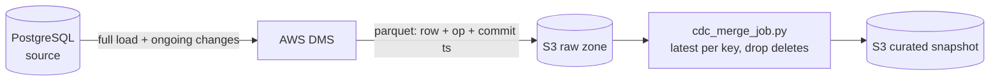

# CDC snapshot job (AWS DMS → S3 → Spark)

Rebuilds the current state of a table from the change files AWS DMS writes to
S3: one row per key, the latest version, deleted keys removed.

| | |
|---|---|
| **Tested** | 10 Spark tests in CI |
| **Deployed** | No. The job runs anywhere `spark-submit` does (EMR, Glue, Databricks) |



## The cases it handles

| Case | What goes wrong naively | What the job does | Test |
|---|---|---|---|
| Out-of-order arrival | An older change that lands late overwrites newer state | Orders by source commit time, not arrival time | `test_handles_late_arriving_events` |
| Full-load rows | DMS writes them with a NULL `op`; `op != 'D'` is NULL, so the filter silently drops them | NULL `op` is treated as an insert | `test_full_load_rows_with_null_op_are_kept` |
| Several changes in one commit | Same timestamp, so "latest" is whatever Spark happens to see first | Tiebreak on a change-sequence column (`--seq-col`), else delete > update > insert | `test_sequence_column_breaks_timestamp_ties`, `test_delete_wins_a_timestamp_tie_without_sequence` |
| Delete after update | The key lingers in the snapshot | Latest change is a delete, so the key is removed | `test_delete_after_update_removes_record` |
| Missing columns | Cryptic analysis error deep in Spark | Fails up front naming the missing columns | `test_raises_on_missing_required_columns` |

## Trade-off

Every run rebuilds the snapshot from the whole raw zone. That is simple and
replay-safe, but it is a full scan. Past a few hundred million change rows the
right design is incremental: `MERGE` only the new change files into a Delta or
Iceberg table (the Silver step in [`../azure-lakehouse`](../azure-lakehouse) does exactly that).

## Run

```bash
pip install -r requirements-dev.txt          # needs Java 17
PYTHONPATH=. pytest -v tests

spark-submit cdc_merge_job.py --input s3://claims-cdc-raw/ --output s3://claims-curated/ \
  --key claim_id --event-ts-col event_ts --op-col op --seq-col change_seq
```

`schema.sql` has the source table and the shape of the raw change files.
