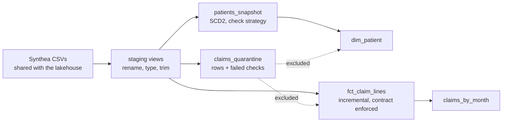

# dbt claims marts on DuckDB

The warehouse-side version of the [Azure lakehouse](../azure-lakehouse): the
same synthetic Synthea files, modelled SQL-first with dbt. Staging views,
a quarantine model, an SCD Type 2 snapshot, an incremental fact with an
enforced contract, data tests, a unit test, and a circuit breaker that fails the
build when too many rows are bad.

| | |
|---|---|
| **Tested** | `dbt build` in CI (29 nodes: models, snapshot, 20 data tests, 1 unit test) plus 2 pytest checks: a second build changes nothing, and a patient move produces a new SCD2 version |
| **Runs locally** | `dbt build`, no warehouse account needed (DuckDB file in `target/`) |



## What each piece shows

| Piece | Detail |
|---|---|
| Sources read in place | `external_location` points DuckDB at the CSVs; nothing is copied into the repo twice. Name and SSN columns are never selected |
| `claims_quarantine` | Bad rows kept with an array of the rules they broke (unknown gender, negative balance, missing links). The marts read everything not in it |
| `assert_quarantine_ratio_under_limit` | Singular test: the build fails if more than 5% of claims are quarantined, the same breaker the Databricks job uses |
| `patients_snapshot` → `dim_patient` | SCD Type 2 with dbt's check strategy; `dbt_valid_to_current` set to 9999-12-31 so "current" is a date comparison, not a NULL check |
| `fct_claim_lines` | Incremental (`delete+insert` on `transaction_id`), `on_schema_change: fail`, and an enforced contract: column names and types are checked at build time |
| Tests | `unique`, `not_null`, `relationships`, `accepted_values`, a custom `non_negative` generic test, a composite-key test, and "payment never exceeds charge" |
| Unit test | `claims_by_month` is checked against hand-written input rows, so the aggregation logic is tested without any real data |
| `store_failures: true` | Every failing test writes its rows to a table in `main_dbt_test__audit` you can query |

Two tests are configured to warn rather than fail, on purpose: the source has
patients with an unknown gender (they go to quarantine), and their claims still
appear in the fact table, so the fact-to-patient relationship reports those
rows instead of hiding them.

## Run

```bash
pip install -r requirements.txt
dbt build --profiles-dir .
pytest -v tests_py          # idempotency + SCD2 checks
```

Querying the result:

```bash
python -c "import duckdb; print(duckdb.connect('target/claims.duckdb').sql('select * from claims_by_month order by month'))"
```
