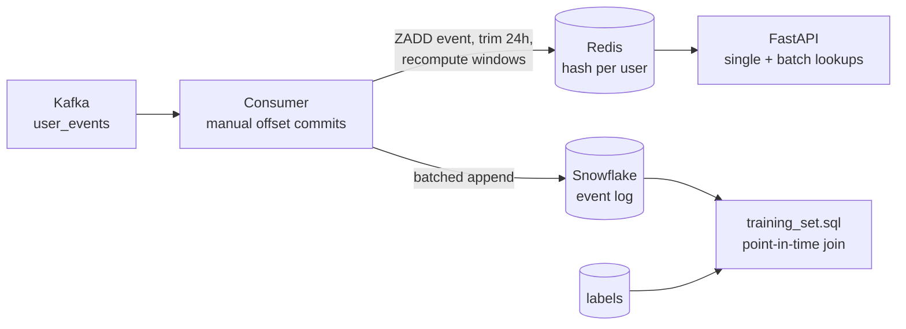

# Real-time feature store: Kafka → Redis (online) + Snowflake (offline)

Fraud-style user features computed from a stream of events, served in one Redis
round trip, and reproducible point-in-time for training.

| | |
|---|---|
| **Tested** | 23 tests in CI: online path on fakeredis, serving API, offline training SQL on DuckDB, and an online/offline parity test |
| **Runs locally** | `docker compose up` (Kafka in KRaft mode, Redis, consumer, API). Snowflake is optional |
| **Measured latency** | Not benchmarked, so no numbers are claimed |



## Features

| Feature | Window | Online (Redis) | Offline (SQL) |
|---|---|---|---|
| `event_count_1h`, `event_count_24h` | rolling | sorted set per user, trimmed to 24h | `COUNT` over events in `(label_ts - w, label_ts]` |
| `cart_value_sum_24h`, `cart_value_max_24h` | rolling | same | `SUM` / `MAX` over the same window |
| `last_event_ts`, `event_type`, `cart_value_usd`, `is_mobile` | latest event | hash fields | latest event at or before `label_ts` |

Both sides use the same window boundaries, and `test_online_and_offline_agree`
checks they produce the same values for the same events. That is the
training/serving skew check, as a test.

## Correctness choices

| Problem | Handling |
|---|---|
| Consumer crashes after reading, before writing | Offsets are committed only after the Redis write and a successful Snowflake flush (at-least-once) |
| At-least-once means replays | Events are stored by `event_id` in the sorted set, so a replay isn't counted twice; the offline SQL dedupes on `event_id` |
| Events arrive out of order | A late event still counts in the windows but can't overwrite the newer "latest event" fields |
| Quiet topic, buffered rows | `poll()` returns on a timeout, so time-based offline flushes still happen |
| Training leakage | `training_set.sql` only reads events with `event_ts <= label_ts` (`test_no_future_leakage`) |

## Run

```bash
docker compose -f infra/docker-compose.yml up -d --build
docker compose -f infra/docker-compose.yml exec consumer python scripts/produce_events.py --bootstrap kafka:29092
curl -X POST localhost:8001/features/get -H 'content-type: application/json' \
  -d '{"entity_id": "user-1", "feature_names": ["event_count_1h", "cart_value_sum_24h"]}'
```

Set `FS_SF_ACCOUNT`, `FS_SF_USER` and `FS_SF_PASSWORD` to also write the
offline log (`offline/ddl.sql` creates the tables). Without them the consumer runs online-only.

```bash
pip install -r requirements-dev.txt
PYTHONPATH=src pytest -v tests
```

## Not built

Feature registry and versioning (Feast/Tecton territory), a Snowpipe Streaming
writer for higher volume, and a latency benchmark.
