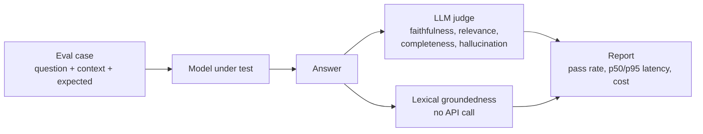

# LLM evaluation harness

Scores model answers before a deployment decision: faithfulness to the
context, relevance, a separate hallucination verdict, latency and cost, plus
retrieval metrics for a RAG system.

| | |
|---|---|
| **Tested** | 18 tests in CI with the judge mocked (no API key needed) |
| **Eval set** | 6 hand-written healthcare policy Q&A cases in `evals/healthcare_qa.json`, including one unanswerable question. The policies are invented |
| **Results** | None published yet. Run it with your key and commit `reports/` to publish real numbers |



## What it measures

| Metric | How | Notes |
|---|---|---|
| Faithfulness, relevance, completeness, conciseness | LLM judge returns 0–1 scores as JSON | Judge and model under test should differ |
| Hallucination | The judge's own true/false verdict, **or** faithfulness < 0.5 | A case with a flagged hallucination fails even if its scores are high |
| Lexical groundedness | Share of the answer's content words found in the context | Cheap first-pass signal, not a verdict |
| Latency | p50 and p95 (nearest rank) | |
| Cost | Input and output tokens × per-model rates in `src/pricing.py` | Override prices with `EVAL_PRICES_JSON` |
| Retrieval: precision@k, recall@k, hit rate, MRR | `src/retrieval_metrics.py` | Needs labelled relevant chunk ids per question |

The answer-quality cases hand the model the ideal context, so they measure
generation only. Retrieval quality is a separate measurement, which is what
`retrieval_metrics.py` is for.

## Run

```bash
pip install -r requirements.txt
PYTHONPATH=src pytest -v tests

export OPENAI_API_KEY=sk-...
python src/compare_models.py      # gpt-4o-mini vs gpt-4o, judged by gpt-4o; writes reports/
```

Any OpenAI-compatible endpoint can be the judge (Azure OpenAI, vLLM, a gateway):
`HarnessConfig(judge_model="...", judge_base_url="https://...")`.
