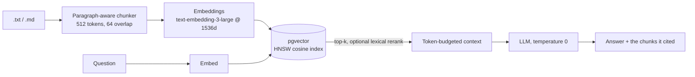

# RAG pipeline: ingestion, retrieval and cited answers on pgvector

A learning project for the data side of LLM applications: how documents become
chunks and vectors, how retrieval finds them, and how the answer stays tied to
its sources.

| | |
|---|---|
| **Tested** | 28 tests in CI: unit tests plus integration tests against a real PostgreSQL + pgvector service (embeddings stubbed, every SQL statement real) |
| **Runs locally** | `docker compose up` (needs an OpenAI API key) |
| **Measured quality** | Not yet. No retrieval or latency benchmark has been run, so this README quotes none. [`../llm-eval-harness`](../llm-eval-harness) has the metrics code to do it |



## Decisions and the problems behind them

| Decision | Why |
|---|---|
| **1536-dimension embeddings** | pgvector can't build an HNSW or IVFFlat index on more than 2,000 dimensions. The first version used 3072 and failed on startup; `IngestConfig` now refuses an unindexable size |
| **HNSW, not IVFFlat** | IVFFlat learns its lists from the rows present at build time, so building it on an empty table gives poor recall. HNSW is built incrementally |
| **Re-ingest replaces the document atomically** | Chunk ids are SHA-256 of doc id, position and full text. Upserting alone leaves stale chunks behind when a document shrinks, so one transaction deletes the doc's old chunks and inserts the new ones (`test_ingest_search_and_reingest`) |
| **Hard context budget** | Retrieved chunks are added until `max_context_tokens` would be exceeded, so a long chunk can't silently blow up cost or truncate the prompt |
| **Citations come from the answer** | `citations` lists only the chunks the model actually cited as `[Chunk n]`, not everything retrieved |
| **Lexical rerank, off by default** | Blends cosine (70%) with query-term overlap (30%) over 20 candidates. Helps when the question has exact terms (codes, names) the embedding under-weights; costs no model call |
| **Prices in one table** | Cost per call uses input and output token rates per model (`src/pricing.py`); unknown models report $0 instead of a guess |

## Run

```bash
export OPENAI_API_KEY=sk-...
docker compose up -d --build

curl -X POST localhost:8000/ingest/text -H 'content-type: application/json' \
  -d '{"doc_id": "policy-1", "text": "Breach notifications must be sent within 60 days of discovery."}'
curl -X POST localhost:8000/query -H 'content-type: application/json' \
  -d '{"question": "How long do we have to send breach notifications?", "top_k": 3}'
```

Tests:

```bash
pip install -r requirements.txt
PYTHONPATH=src pytest -v tests                       # unit tests
RAG_TEST_DATABASE_URL=postgresql://... PYTHONPATH=src pytest -v tests   # + pgvector integration
```

## Not built

PDF parsing (text formats only), multi-tenant filtering, a cross-encoder
reranker, and a measured benchmark. Those are the next steps, in roughly that order of value: benchmark first.
